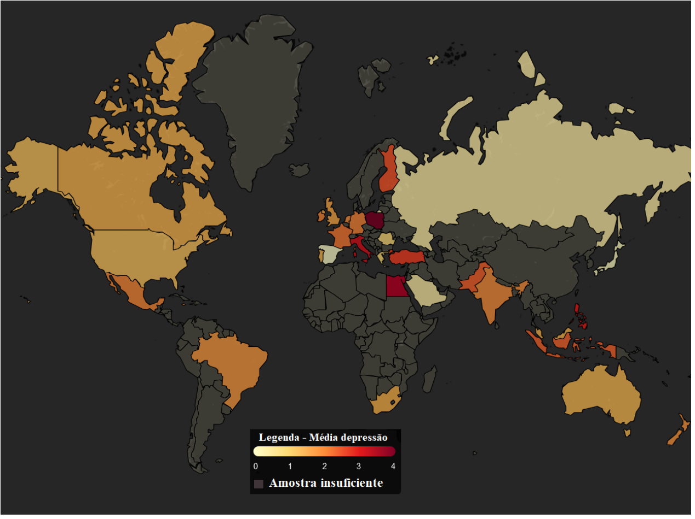
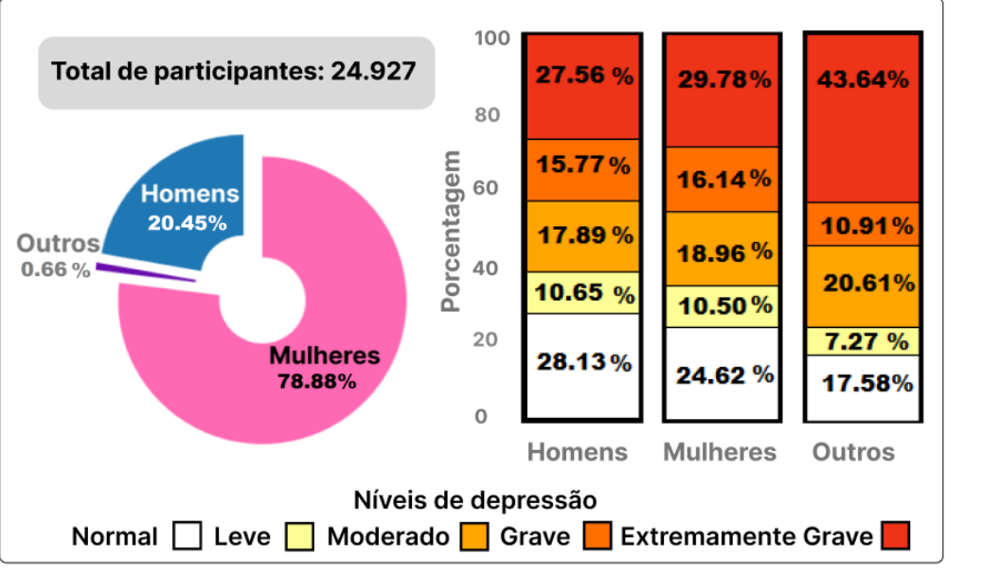
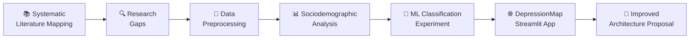
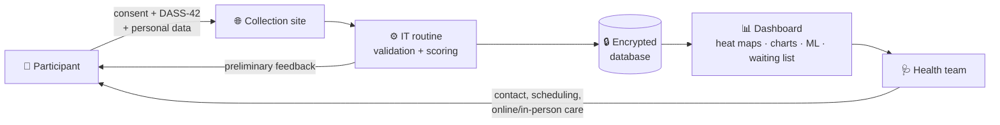

<div align="center">

<a href="README.md"></a>
<a href="README.pt-BR.md"></a>

<br><br>

# 🧠 DepressionMap

### A System for Depression Indicators and Sociodemographic Data Analysis

*Turning DASS-42 responses into visual, actionable mental-health indicators with data analysis and Machine Learning.*

<br>

[](https://depression-map.streamlit.app/)
[](https://bit.ly/415vLfQ)
[](#-citation)


</div>

---

## 📌 Table of Contents

- [About](#-about)
- [Highlights](#-highlights)
- [How It Works](#-how-it-works)
- [The DASS-42 Depression Subscale](#-the-dass-42-depression-subscale)
- [Dataset](#-dataset)
- [Machine Learning Results](#-machine-learning-results)
- [Sociodemographic Insights](#-sociodemographic-insights)
- [Improved Architecture (Proposal)](#-improved-architecture-proposal)
- [Running Locally](#-running-locally)
- [Limitations & Ethics](#%EF%B8%8F-limitations--ethics)
- [Citation](#-citation)
- [Author](#-author)

---

## 💡 About

According to the World Health Organization, depression rose by **more than 25%** after the COVID-19 pandemic and is the **most disabling mental condition in the world**.

**DepressionMap** is a *Smart Health* system that generates depression indicators based on the **DASS-42** scale and **sociodemographic variables**, and reports how different **Machine Learning** algorithms perform when classifying depression severity levels. The goal is to support mental-health professionals in **screening**, identifying **vulnerable groups**, and **mapping the most affected regions**.

> Developed as a Master's dissertation in Computer Science at the **Federal University of Sergipe (UFS)** — PROCC, 2025.

---

## ✨ Highlights

<table>
<tr>
<td width="33%" align="center">

### 🗺️
**Interactive Heat Map**<br>
Average depression level by country (34 countries, 6 regions)

</td>
<td width="33%" align="center">

### 📊
**Sociodemographic Dashboards**<br>
Gender, age, marital status and education vs. depression levels

</td>
<td width="33%" align="center">

### 🤖
**ML Benchmark**<br>
7 classifiers compared, up to **99.69%** accuracy

</td>
</tr>
</table>

<!-- 📸 Add screenshots of the app here, e.g.:
<p align="center">
  
  
</p>
-->

---

## ⚙️ How It Works



The app has two pages:

| Page | What you'll find |
|---|---|
| 🏠 **Home** | World heat map of average depression levels + country selector with pie and bar charts relating depression to gender, age, marital status and education |
| 🤖 **Artificial Intelligence** | Accuracy and F1-score comparison of ML algorithms classifying depression severity |

---

## 📝 The DASS-42 Depression Subscale

The depression score is the sum of **14 items** (Q3, Q5, Q10, Q13, Q16, Q17, Q21, Q24, Q26, Q31, Q34, Q37, Q38, Q42), each rated from **0** (*did not apply to me at all*) to **3** (*applied to me very much*).

| Level | Score | |
|:---:|:---:|:---:|
| 0 · Normal | 0 – 9 | 🟢 |
| 1 · Mild | 10 – 13 | 🟡 |
| 2 · Moderate | 14 – 20 | 🟠 |
| 3 · Severe | 21 – 27 | 🔴 |
| 4 · Extremely Severe | 28+ | 🟣 |

---

## 🗂️ Dataset

Public, anonymous dataset from [**Open Psychometrics**](https://openpsychometrics.org/) — **39,775** responses collected between 2017 and 2019 (172 columns).

**Preprocessing pipeline**

1. Selected **19 columns**: 14 DASS-42 depression items + country, age, gender, marital status and education
2. Shifted answers from `1–4` to the official `0–3` scale
3. Computed depression scores and severity levels
4. Removed countries with **fewer than 30** respondents (Central Limit Theorem)
5. Dropped rows with missing values and invalid ranges (adults 18–100 only)

<div align="center">

**39,775** raw rows ➜ **24,927** clean responses · **34** countries · **6** regions

</div>

---

## 🤖 Machine Learning Results

**Setup:** One-Hot Encoding · Min-Max normalization · SMOTE balancing · 80/20 split · 10-Fold Cross-Validation · default hyperparameters

| Model | Accuracy | Precision | Recall | F1-score |
|---|:---:|:---:|:---:|:---:|
| 🥇 **Logistic Regression** | **0.9969** | **0.9969** | **0.9969** | **0.9969** |
| 🥈 **SVM** | **0.9966** | **0.9966** | **0.9966** | **0.9966** |
| 🥉 Random Forest | 0.9592 | 0.9594 | 0.9592 | 0.9592 |
| K-Nearest Neighbors | 0.9187 | 0.9231 | 0.9187 | 0.9192 |
| Decision Tree | 0.8463 | 0.8462 | 0.8463 | 0.8461 |
| Gaussian Naive Bayes | 0.6854 | 0.7350 | 0.6854 | 0.6866 |
| AdaBoost | 0.4936 | 0.5946 | 0.4936 | 0.4359 |

**Statistical validation** (α = 0.05, via [Autorank](https://github.com/sherbold/autorank)): Shapiro-Wilk ➜ Bartlett ➜ Friedman ➜ Nemenyi post-hoc.
Logistic Regression and SVM are **statistically equivalent** (p = 0.78 accuracy / 0.90 F1) and significantly better than Random Forest.

<details>
<summary><b>📈 Comparison with related work (accuracy %)</b></summary>

<br>

| Model | **This study** | Srinath et al. (2022) | Singh et al. (2022) |
|---|:---:|:---:|:---:|
| Logistic Regression | **99.69** | 98.15 | – |
| SVM | **99.66** | 97.35 | 94.00 |
| Random Forest | **95.92** | 84.97 | 85.00 |
| KNN | **91.87** | 75.14 | 73.00 |
| Decision Tree | **84.63** | – | 75.00 |
| Gaussian Naive Bayes | **68.54** | – | 33.00 |
| AdaBoost | 49.36 | – | **80.00** |

</details>

---

## 🌍 Sociodemographic Insights

| Group | Highest average | Lowest average |
|---|---|---|
| **Gender** | Other (2.56) | Male (2.04) |
| **Age** | 18–34 (2.19) | 55+ (1.66) |
| **Marital status** | Never married (2.22) | Married (1.60) |
| **Education** | High school (2.28) | Postgraduate (1.91) |
| **Region** | Africa (2.36) | Australia/New Zealand (2.16) |

> ⚠️ These figures describe this specific public sample (mostly Asian, female and young respondents) and **should not be generalized**. The focus of the work is the system's ability to produce indicators, not the findings themselves.

---

## 🏥 Improved Architecture (Proposal)

The current version was built purely in a computational context. The proposed structure adds **controlled data collection** and a **mental-health team** in the loop — because DASS is a screening tool, **not a diagnosis**.



---

## 🚀 Running Locally

```bash
# clone the repository
git clone https://github.com/<your-username>/<your-repo>.git
cd <your-repo>

# install dependencies
pip install -r requirements.txt

# run the app
streamlit run app.py
```

<details>
<summary><b>📦 Library versions used</b></summary>

<br>

| Library | Version |
|---|---|
| NumPy | 1.26.4 |
| Pandas | 2.2.2 |
| Streamlit | 1.41.1 |
| Matplotlib | 3.9.0 |
| Plotly | 5.22.0 |
| GeoJSON | 3.1.0 |
| Folium | 0.17.0 |
| Scikit-learn | 1.6.0 |
| Imbalanced-learn | 0.13.0 |
| Autorank | 1.2.1 |

</details>

---

## ⚠️ Limitations & Ethics

- 🔸 **Not a diagnostic tool.** DASS-42 results are screening indicators only and do not replace a mental-health professional.
- 🔸 Public dataset with no control over data collection; possible incorrect answers.
- 🔸 Imbalanced sample (most participants from Asia, female, aged 18–34).
- 🔸 Row removal during preprocessing may introduce bias.
- 🔸 Anonymous secondary data, exempt from CEP/CONEP review under Brazilian CNS Resolution No. 510/2016.

> 💚 If you are struggling, please reach out to a mental-health professional or a local support service. In Brazil, **CVV** is available 24h at **188** or [cvv.org.br](https://cvv.org.br).

---

## 📖 Citation

```bibtex
@mastersthesis{sa2025depressionmap,
  author  = {Noirane Getirana de Sá},
  title   = {DepressionMap: Um Sistema Para Indicadores de Depressão e Análise de Dados Sociodemográficos},
  school  = {Universidade Federal de Sergipe},
  address = {São Cristóvão, Sergipe, Brazil},
  year    = {2025},
  type    = {Master's dissertation},
  note    = {Programa de Pós-Graduação em Ciência da Computação (PROCC). Advisor: Prof. Dr. Gilton José Ferreira da Silva}
}
```

---

## 👩‍💻 Author

<div align="center">

**Noirane Getirana de Sá**<br>
M.Sc. in Computer Science · Federal University of Sergipe (UFS)

Advisor: **Prof. Dr. Gilton José Ferreira da Silva**<br>
Examining board: Prof.ª Dr.ª Zenith Nara Costa Delabrida · Prof. Dr. Fábio Gomes Rocha

<sub>Funded by FAPITEC-SE (Fundação de Apoio à Pesquisa e à Inovação Tecnológica do Estado de Sergipe)</sub>

<br>

[](https://depression-map.streamlit.app/)

⭐ *If this project was useful to you, consider giving it a star!*

</div>
