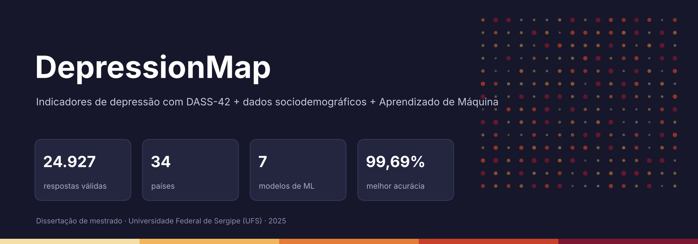
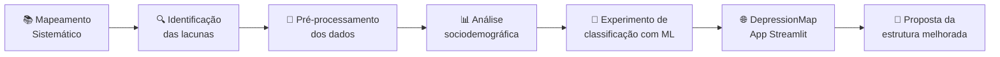
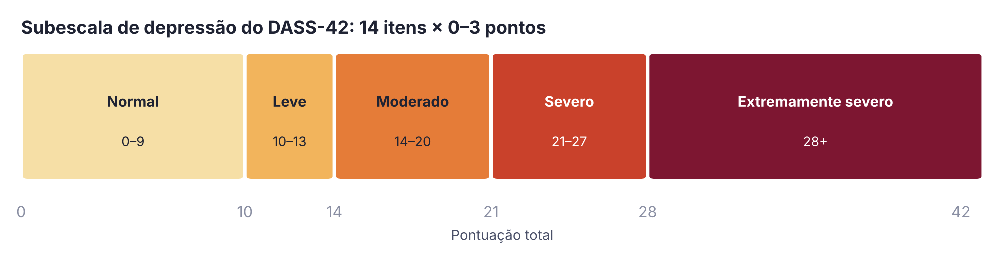
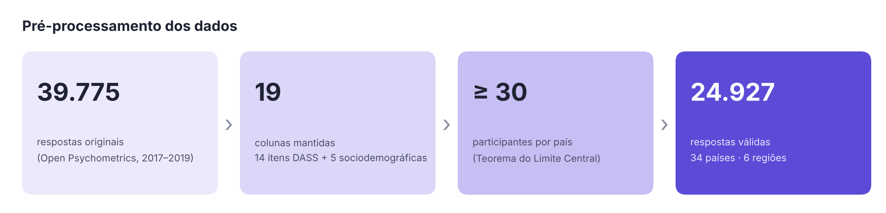
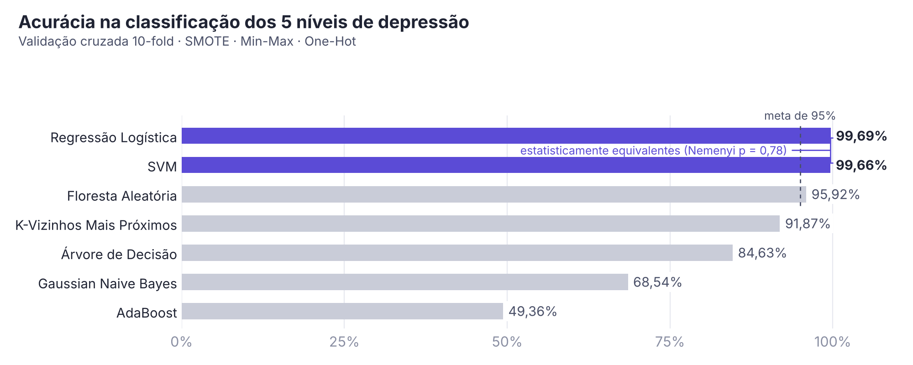
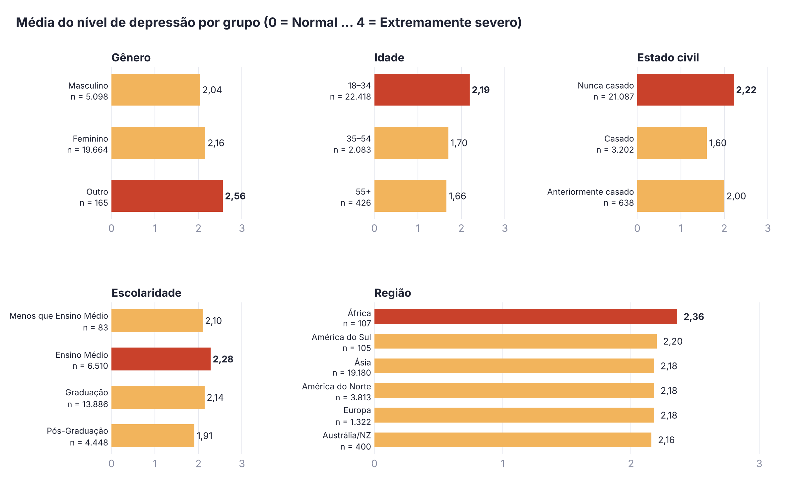
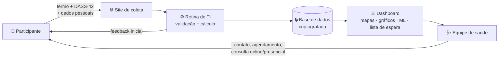
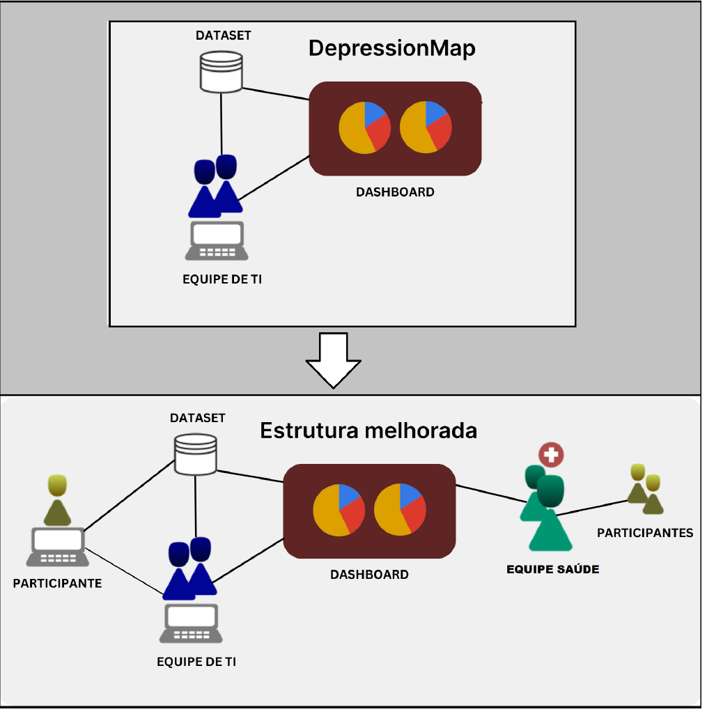

<div align="center">

<a href="README.md"></a>
<a href="README.pt-BR.md"></a>

<br><br>



### Um Sistema Para Indicadores de Depressão e Análise de Dados Sociodemográficos

<br>

[](https://depression-map.streamlit.app/)
[](https://bit.ly/415vLfQ)
[](#-como-citar)


</div>

---

## 📌 Sumário

- [Sobre](#-sobre)
- [Destaques](#-destaques)
- [Como Funciona](#%EF%B8%8F-como-funciona)
- [Subescala de Depressão do DASS-42](#-subescala-de-depressão-do-dass-42)
- [Base de Dados](#%EF%B8%8F-base-de-dados)
- [Resultados de Aprendizado de Máquina](#-resultados-de-aprendizado-de-máquina)
- [Análise Sociodemográfica](#-análise-sociodemográfica)
- [Estrutura Melhorada (Proposta)](#-estrutura-melhorada-proposta)
- [Executando Localmente](#-executando-localmente)
- [Limitações e Ética](#%EF%B8%8F-limitações-e-ética)
- [Como Citar](#-como-citar)
- [Autora](#-autora)

---

## 💡 Sobre

Segundo a Organização Mundial da Saúde, após a pandemia de COVID-19 a depressão aumentou **mais de 25%**, sendo a **condição mental mais incapacitante do mundo**.

O **DepressionMap** é um sistema de *Saúde Inteligente* que gera indicadores de depressão com base na escala **DASS-42** e em **variáveis sociodemográficas**, além de apresentar o desempenho de diferentes algoritmos de **Aprendizado de Máquina** na classificação dos níveis de severidade da doença. O objetivo é apoiar profissionais de saúde mental na **triagem**, na identificação de **grupos vulneráveis** e no **mapeamento das áreas mais afetadas**.

> Desenvolvido como dissertação de Mestrado em Ciência da Computação na **Universidade Federal de Sergipe (UFS)** — PROCC, 2025.

---

## ✨ Destaques

<table>
<tr>
<td width="33%" align="center">

### 🗺️
**Mapa de Calor Interativo**<br>
Média de depressão por país (34 países, 6 regiões)

</td>
<td width="33%" align="center">

### 📊
**Painéis Sociodemográficos**<br>
Gênero, idade, estado civil e escolaridade x níveis de depressão

</td>
<td width="33%" align="center">

### 🤖
**Comparativo de ML**<br>
7 classificadores, até **99,69%** de acurácia

</td>
</tr>
</table>

<p align="center">
  
</p>
<p align="center"><sub>🗺️ Mapa de calor do app: tons claros = menor média de depressão, vermelho escuro = maior, cinza = menos de 30 participantes</sub></p>

---

## ⚙️ Como Funciona



O sistema possui duas páginas:

| Página | O que você encontra |
|---|---|
| 🏠 **Página Inicial** | Mapa de calor mundial com a média de depressão + seleção de país com gráficos de pizza e barras relacionando depressão a gênero, idade, estado civil e escolaridade |
| 🤖 **Inteligência Artificial** | Comparativo de acurácia e medida-F1 dos algoritmos na classificação dos níveis de depressão |

---

## 📝 Subescala de Depressão do DASS-42

A pontuação de depressão é a soma de **14 itens** (Q3, Q5, Q10, Q13, Q16, Q17, Q21, Q24, Q26, Q31, Q34, Q37, Q38, Q42), cada um avaliado de **0** (*não se aplica a mim de forma alguma*) a **3** (*aplica-se a mim muito, ou a maior parte do tempo*).

<p align="center"></p>

---

## 🗂️ Base de Dados

Dataset público e anônimo do [**Open Psychometrics**](https://openpsychometrics.org/) — **39.775** respostas coletadas entre 2017 e 2019 (172 colunas).

**Etapas do pré-processamento**

1. Seleção de **19 colunas**: 14 itens de depressão do DASS-42 + país, idade, gênero, estado civil e escolaridade
2. Ajuste das respostas de `1–4` para a escala oficial `0–3`
3. Cálculo das pontuações e dos níveis de severidade
4. Remoção de países com **menos de 30** participantes (Teorema do Limite Central)
5. Exclusão de linhas com valores ausentes ou fora dos intervalos válidos (apenas adultos de 18 a 100 anos)

<p align="center"></p>

---

## 🤖 Resultados de Aprendizado de Máquina

**Configuração:** One-Hot Encoding · Normalização Min-Max · Balanceamento com SMOTE · Divisão 80/20 · Validação Cruzada 10-Fold · Parâmetros padrão

<p align="center"></p>

<details>
<summary><b>📋 Tabela completa de métricas</b></summary>

<br>

| Modelo | Acurácia | Precisão | Sensibilidade | Medida-F1 |
|---|:---:|:---:|:---:|:---:|
| 🥇 **Regressão Logística** | **0,9969** | **0,9969** | **0,9969** | **0,9969** |
| 🥈 **SVM** | **0,9966** | **0,9966** | **0,9966** | **0,9966** |
| 🥉 Floresta Aleatória | 0,9592 | 0,9594 | 0,9592 | 0,9592 |
| K-Vizinhos Mais Próximos | 0,9187 | 0,9231 | 0,9187 | 0,9192 |
| Árvore de Decisão | 0,8463 | 0,8462 | 0,8463 | 0,8461 |
| Gaussian Naive Bayes | 0,6854 | 0,7350 | 0,6854 | 0,6866 |
| AdaBoost | 0,4936 | 0,5946 | 0,4936 | 0,4359 |

</details>

**Validação estatística** (α = 0,05, com [Autorank](https://github.com/sherbold/autorank)): Shapiro-Wilk ➜ Bartlett ➜ Friedman ➜ Post-Hoc de Nemenyi.
Regressão Logística e SVM são **estatisticamente equivalentes** (p = 0,78 acurácia / 0,90 medida-F1) e significativamente superiores à Floresta Aleatória.

<details>
<summary><b>📈 Comparação com trabalhos relacionados (acurácia %)</b></summary>

<br>

| Modelo | **Este estudo** | Srinath et al. (2022) | Singh et al. (2022) |
|---|:---:|:---:|:---:|
| Regressão Logística | **99,69** | 98,15 | – |
| SVM | **99,66** | 97,35 | 94,00 |
| Floresta Aleatória | **95,92** | 84,97 | 85,00 |
| KNN | **91,87** | 75,14 | 73,00 |
| Árvore de Decisão | **84,63** | – | 75,00 |
| Gaussian Naive Bayes | **68,54** | – | 33,00 |
| AdaBoost | 49,36 | – | **80,00** |

</details>

---

## 🌍 Análise Sociodemográfica

<p align="center"></p>

<details>
<summary><b>🖥️ Como o app mostra (exemplo: gênero)</b></summary>

<br>

<p align="center"></p>
<p align="center"><sub>Pizza: proporção de participantes por gênero · Barras empilhadas: % de cada nível de depressão por grupo</sub></p>

</details>

> ⚠️ Esses números descrevem esta amostra pública específica (majoritariamente asiática, feminina e jovem) e **não devem ser generalizados**. O foco do trabalho é a capacidade do sistema de gerar indicadores, e não os resultados em si.

---

## 🏥 Estrutura Melhorada (Proposta)

A versão atual foi construída apenas em contexto computacional. A estrutura proposta adiciona **controle na coleta de dados** e uma **equipe de saúde mental** no processo — afinal, o DASS é uma ferramenta de triagem, **não um diagnóstico**.



<details>
<summary><b>🖼️ Figura original da dissertação</b></summary>

<br>

<p align="center"></p>

</details>

---

## 🚀 Executando Localmente

```bash
# clone o repositório
git clone https://github.com/<seu-usuario>/<seu-repo>.git
cd <seu-repo>

# instale as dependências
pip install -r requirements.txt

# execute o app
streamlit run app.py
```

<details>
<summary><b>📦 Versões das bibliotecas utilizadas</b></summary>

<br>

| Biblioteca | Versão |
|---|---|
| NumPy | 1.26.4 |
| Pandas | 2.2.2 |
| Streamlit | 1.41.1 |
| Matplotlib | 3.9.0 |
| Plotly | 5.22.0 |
| GeoJSON | 3.1.0 |
| Folium | 0.17.0 |
| Scikit-learn | 1.6.0 |
| Imbalanced-learn | 0.13.0 |
| Autorank | 1.2.1 |

</details>

---

## ⚠️ Limitações e Ética

- 🔸 **Não é uma ferramenta de diagnóstico.** Os resultados do DASS-42 são apenas indicadores de triagem e não substituem um profissional de saúde mental.
- 🔸 Dataset público, sem controle sobre a coleta; podem existir respostas incorretas.
- 🔸 Amostra desbalanceada (maioria da Ásia, mulheres e pessoas de 18 a 34 anos).
- 🔸 A remoção de linhas no pré-processamento pode gerar viés.
- 🔸 Dados secundários anônimos, dispensados de avaliação pelo sistema CEP/CONEP conforme a Resolução CNS nº 510/2016.

> 💚 Se você estiver passando por um momento difícil, procure um profissional de saúde mental. O **CVV** atende 24h pelo número **188** ou em [cvv.org.br](https://cvv.org.br).

---

## 📖 Como Citar

```bibtex
@mastersthesis{sa2025depressionmap,
  author  = {Noirane Getirana de Sá},
  title   = {DepressionMap: Um Sistema Para Indicadores de Depressão e Análise de Dados Sociodemográficos},
  school  = {Universidade Federal de Sergipe},
  address = {São Cristóvão, Sergipe, Brasil},
  year    = {2025},
  type    = {Dissertação de mestrado},
  note    = {Programa de Pós-Graduação em Ciência da Computação (PROCC). Orientador: Prof. Dr. Gilton José Ferreira da Silva}
}
```

---

## 👩‍💻 Autora

<div align="center">

**Noirane Getirana de Sá**<br>
Mestre em Ciência da Computação · Universidade Federal de Sergipe (UFS)

Orientador: **Prof. Dr. Gilton José Ferreira da Silva**<br>
Banca: Prof.ª Dr.ª Zenith Nara Costa Delabrida · Prof. Dr. Fábio Gomes Rocha

<sub>Bolsa concedida pela FAPITEC-SE (Fundação de Apoio à Pesquisa e à Inovação Tecnológica do Estado de Sergipe)</sub>

<br>

[](https://depression-map.streamlit.app/)

⭐ *Se este projeto foi útil para você, deixe uma estrela!*

</div>
